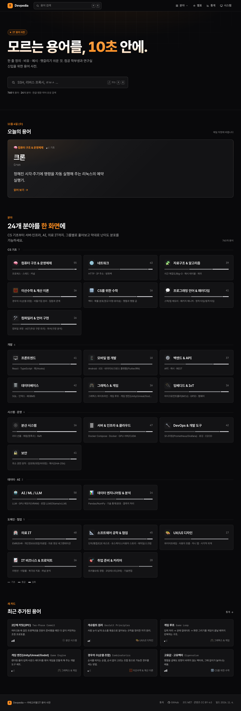
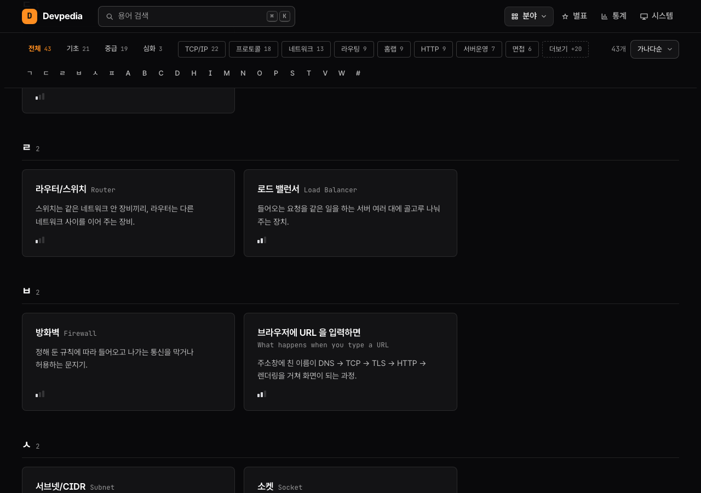
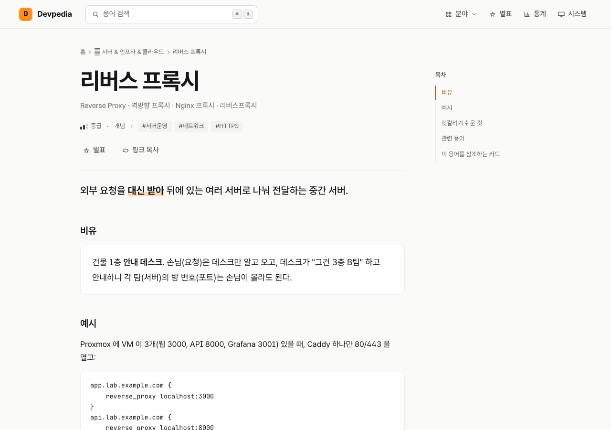
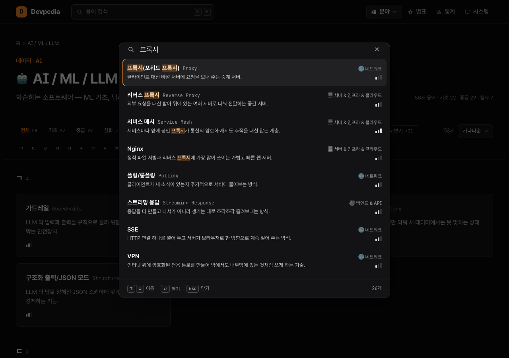

# Devpedia — 카테고리별 IT 용어 사전

IT 용어를 "한 줄 정의 + 비유 + 예시 + 관련 용어" 카드로 정리해 분야별로 훑어보고 검색하는, 서버 없는 정적 웹 사전(PWA)입니다. 컴공 학부생과 연구실 신입이 모르는 용어를 10초 안에 이해하도록 만들었습니다.

| 항목 | 내용 |
| :-- | :-- |
| 기간 | 2026.09 ~ (설계 문서 2026-09-25, 모션 업그레이드 2026-11-04) |
| 역할 | 개인 프로젝트 |
| 규모 | 용어 카드 760장 · 24개 분야(5개 그룹) |
| 기술 스택 | React 19 · TypeScript · Vite · Motion · anime.js · MiniSearch · vite-plugin-pwa · zod · marked · Vitest |
| 사이트 | <https://seung1won-dot.github.io/devpedia/> (GitHub Pages, GitHub Actions 자동 배포) |
| 상태 | 운영 중 · 카드 760장 중 757장은 검토 대기(`review`) |

<table>
  <tr>
    <td width="50%" valign="top"><b>홈</b><br></td>
    <td width="50%" valign="top"><b>분야 페이지</b><br></td>
  </tr>
  <tr>
    <td valign="top"><b>용어 페이지</b><br></td>
    <td valign="top"><b>검색 팔레트</b><br></td>
  </tr>
</table>

통계·분야 메뉴·다른 화면 크기(375 · 768 · 1920px) 스크린샷은 [`docs/redesign/screenshots/`](docs/redesign/screenshots/)에 있습니다.

## 목차

- [주요 기능](#주요-기능)
- [기술 스택](#기술-스택)
- [시작하기](#시작하기)
- [프로젝트 구조](#프로젝트-구조)
- [더 읽을거리](#더-읽을거리)
- [라이선스](#라이선스)

## 주요 기능

- **홈** — 첫 방문 때 제목 글자가 하나씩 떠오르는 인트로, 큰 검색창, 오늘의 용어, 최근 본·별표한 용어, 24개 분야를 5개 그룹으로 묶은 타일(난이도 비율 막대), 최근 추가된 용어
- **분야 페이지** — 스크롤하면 붙는 필터 바(난이도 탭·태그·정렬), ㄱㄴㄷ·A–Z 섹션과 빠른 이동. 1280px 이상에서는 카드를 누르면 오른쪽에 미리보기 패널이 열립니다
- **용어 페이지** — 한 줄 정의·비유·예시·헷갈리기 쉬운 것·관련 용어·역링크, 같은 분야 이전/다음, 넓은 화면 목차
- **검색 팔레트** — `/` 또는 ⌘K·Ctrl+K. 한글·영문·약어·초성(ㄹㅂㅅ → 리버스 프록시) 검색, 오타 허용, 하이라이트, 최근 검색
- **통계** — 분야·난이도·카드 종류별 막대 차트. 화면에 들어오면 막대가 자라고, 막대에 올리면 "N개 · 전체의 n%"가 보입니다
- **절제된 모션** — 화면 전환, 섹션 등장, 난이도 탭 밑줄, 별표에만 짧게 움직입니다. 시스템의 "동작 줄이기" 설정을 켜면 이동 애니메이션이 꺼집니다
- **딥링크** — `#/t/ssh`처럼 카드 하나를 바로 여는 공유 링크. 예전 주소(`#ssh`, `#c/os`)도 새 주소로 바뀝니다
- **별표 · 다크/라이트** — 복습할 용어 표시(이 기기에 저장), 시스템 설정을 따르는 테마와 토글
- **PWA** — 홈 화면 설치, 오프라인 열람, 새 버전 안내
- **빌드 시 검증** — 필드·정의 길이·관계·중복·태그를 검사해 규칙을 어긴 카드는 배포되지 않습니다

## 기술 스택

| 기술 | 쓰는 이유 |
| :-- | :-- |
| React + TypeScript + Vite | 해시 라우팅 SPA를 정적 파일로 빌드해 GitHub Pages에 그대로 올립니다 |
| MiniSearch | 서버 없이 브라우저 안에서 가중치·접두·오타 허용 검색 |
| Motion (`motion/react`) | 화면 전환·섹션 등장·탭 밑줄·통계 차트. `LazyMotion`으로 필요할 때만 받습니다 |
| anime.js v4 | 홈 첫 화면 인트로 전용. 홈에 들어올 때만 따로 받습니다 |
| zod · marked | 카드 frontmatter 검증, 마크다운은 빌드 때 한 번만 HTML로 렌더 |
| vite-plugin-pwa | 서비스 워커 프리캐시로 오프라인 열람 |

## 시작하기

Node.js 22 이상이 필요합니다.

```bash
npm install
```

```bash
npm run dev        # 카드 → public/terms.json 생성 후 개발 서버
```

브라우저에서 <http://localhost:5173> 을 엽니다. PWA·오프라인 동작은 빌드 후 미리보기에서 확인합니다.

```bash
npm run build && npm run preview   # http://localhost:4173
```

| 명령 | 하는 일 |
| :-- | :-- |
| `npm run validate` | 카드 규칙 검사 (`-- --lenient`로 없는 related id를 경고로 낮춤) |
| `npm run build:terms` | 검증 + `public/terms.json` 생성 |
| `npm run build` | 검증 + JSON + Vite 정적 빌드 → `dist/` |
| `npm test` / `npm run typecheck` | Vitest / tsc |
| `npm run check` | validate → typecheck → test → build (CI와 동일) |
| `npm run new -- <category> <id> "<표시 이름>"` | 카드 파일 스캐폴드 |
| `npm run icons` | `public/icon.svg` → PWA PNG 아이콘 |

## 프로젝트 구조

```text
taxonomy/   분야 24개(5개 그룹) · 허용 태그 목록
terms/      용어 카드 Markdown (<category>/<id>.md) · _inbox.md 수집함
scripts/    카드 검증 · terms.json 빌드 · 스캐폴드 · 아이콘 생성
src/        React 앱 — pages/ · components/ · lib/(검색·한글·라우팅·모션) · styles/
docs/       설계 스펙 · 카드 작성법 · 동작 방식 · 리디자인 기록 · 진행 현황
.github/    CI(검증·테스트·Lighthouse·Pages 배포) · PR 템플릿
```

## 더 읽을거리

- [동작 방식 · 배포](docs/architecture.md) — 데이터 흐름(인덱스·본문 JSON 분리), 딥링크 표, 검색 가중치, 콘텐츠 신뢰 경계, GitHub Pages 설정
- [카드 쓰는 법 · 분야 목록](docs/cards.md) — 카드 형식, 검증 규칙, 24개 분야 표, 횡단 태그와 `kind`
- [기여 가이드](CONTRIBUTING.md) — 수집 → 초안 → 검토·발행 워크플로, 커밋 규칙
- [리디자인 · 모션 기록](docs/redesign/README.md) — 디자인 토큰과 대비 측정, Lighthouse 결과, 모션 규칙(2026-11)
- [진행 현황 · 카드 추가 기록 · 로드맵](docs/status.md)
- [설계 문서](docs/superpowers/specs/2026-09-25-devpedia-design.md) · [LLM 초안 프롬프트](docs/llm-draft-prompt.md)

## 라이선스

코드는 [MIT](LICENSE), 용어 카드 콘텐츠는 CC BY 4.0입니다.
